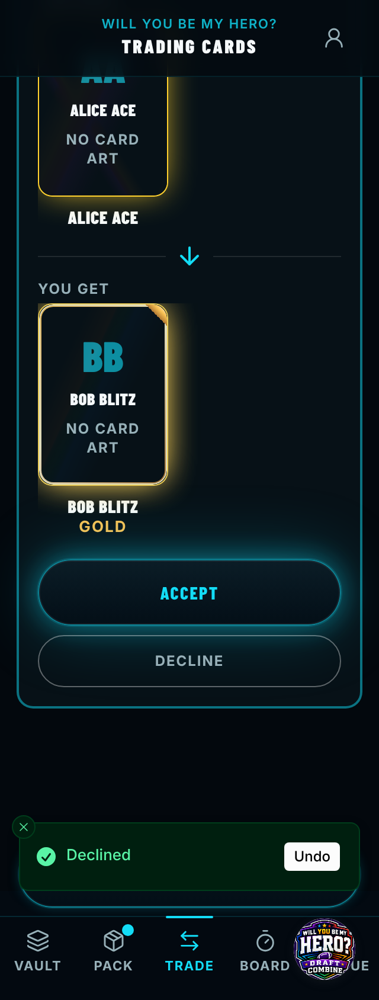
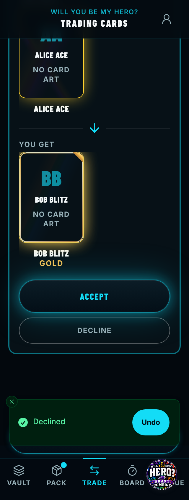
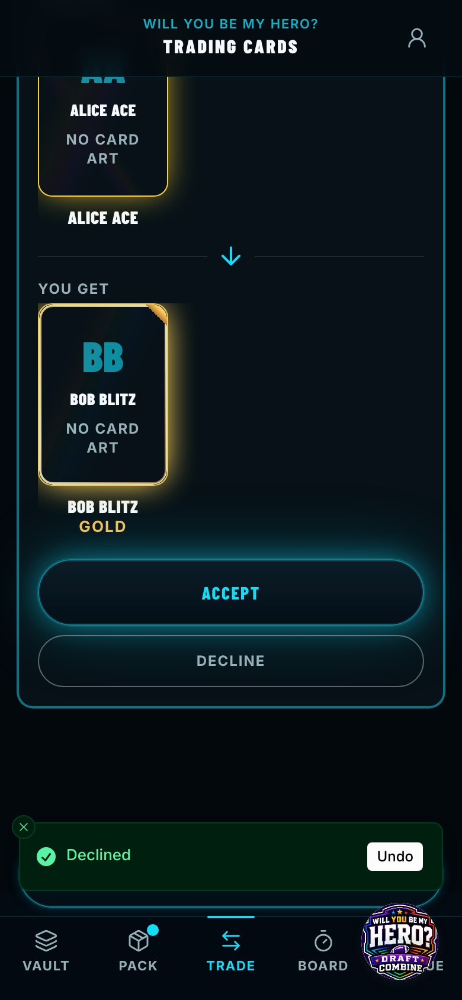
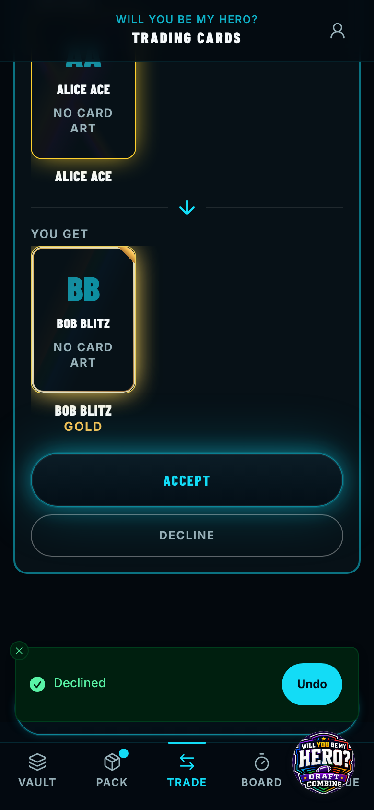
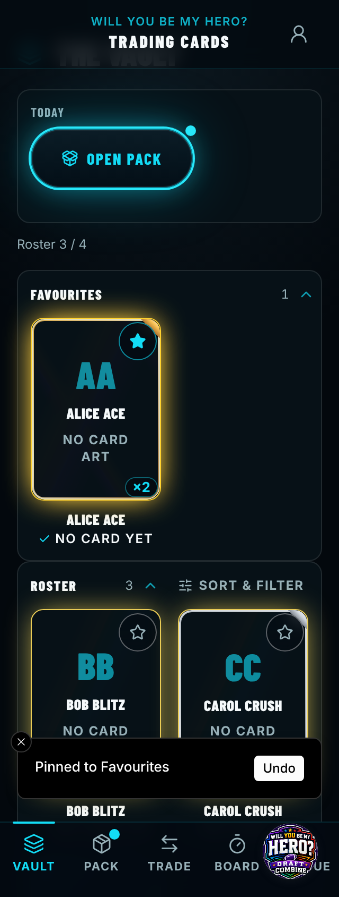
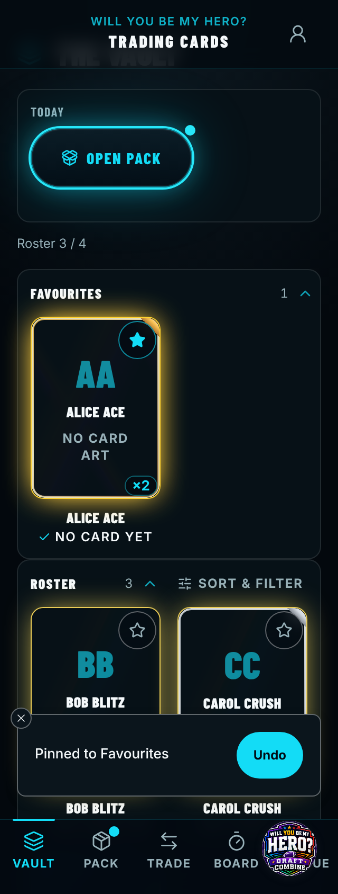
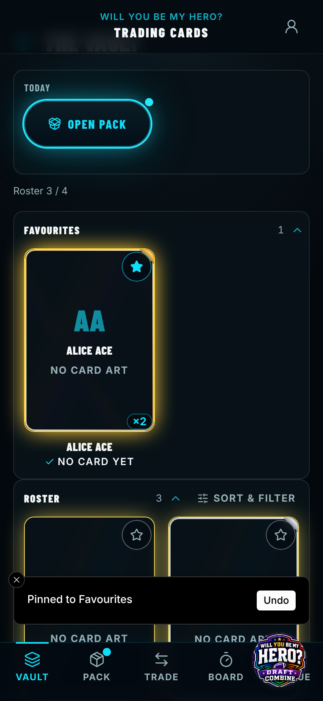
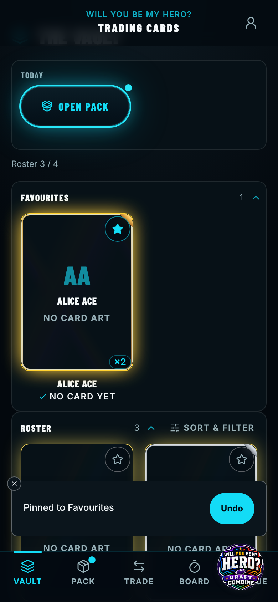

# Before / after — 2026-11-06-name-input-label-and-on-theme-toasts

> Captured against stubbed data (no live backend). The "Live feed down" banner, an artifact of the
> capture's deliberately dead backend that appears at random moments, is hidden in both sets.

| Capture | Pixels | Before | After |
| --- | --- | --- | --- |
| `trade-declined-toast-320.png` | **changed 1.45%** |  |  |
| `trade-declined-toast-390.png` | **changed 1.24%** |  |  |
| `vault-pinned-320.png` | **changed 6.89%** |  |  |
| `vault-pinned-390.png` | **changed 6.74%** |  |  |
