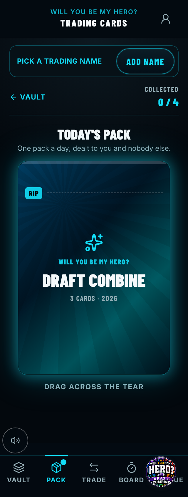
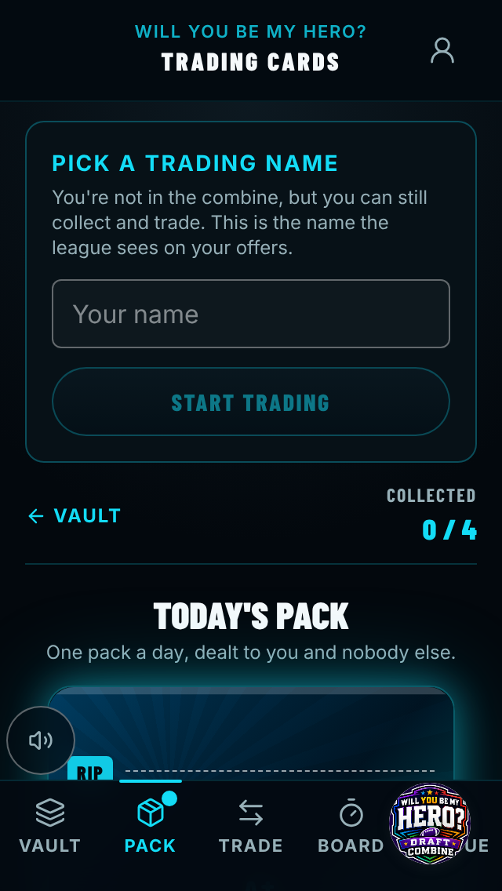
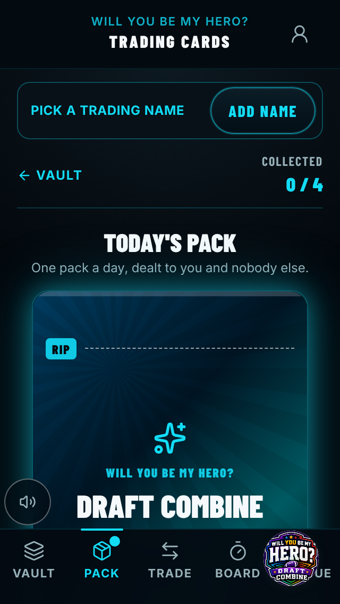
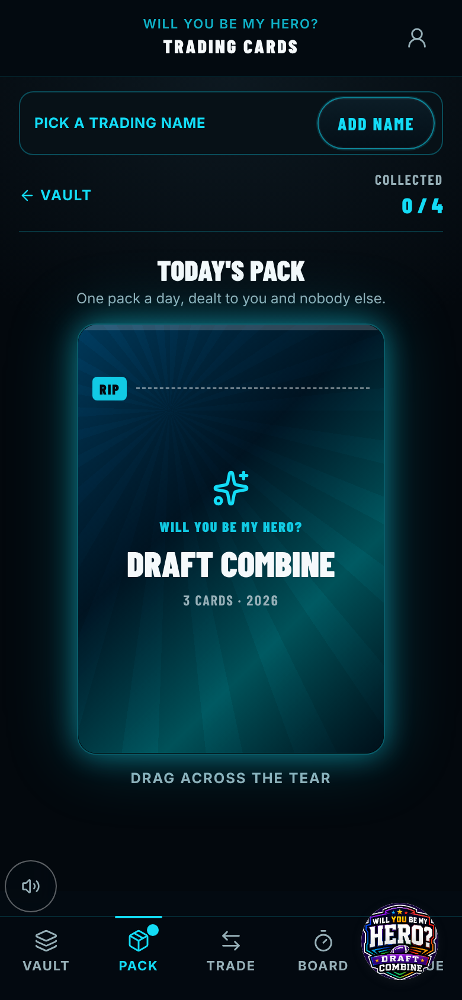
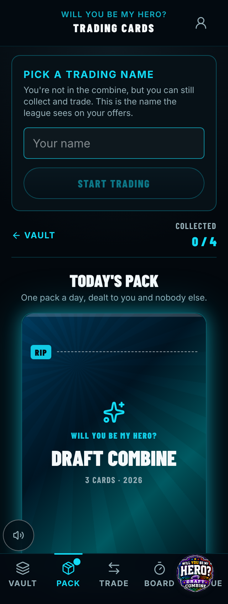
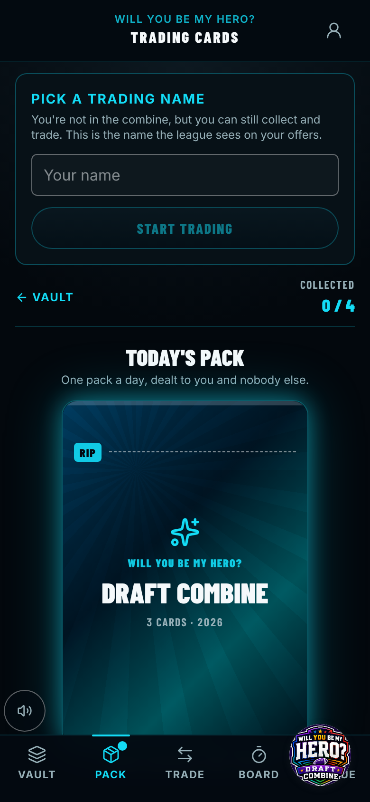

# Before / after — 2026-11-06-pack-collapsed-name-prompt-for-signed-in

> Captured against stubbed data (no live backend). The "Live feed down" banner, an artifact of the
> capture's deliberately dead backend that appears at random moments, is hidden in both sets.

| Capture | Pixels | Before | After |
| --- | --- | --- | --- |
| `pack-sealed-guest-320.png` | **changed 46.51%** |  |  |
| `pack-sealed-guest-320x568.png` | **changed 35.89%** |  |  |
| `pack-sealed-guest-390.png` | **changed 38.72%** |  |  |
| `pack-sealed-guest-open-320.png` | **changed 0.22%** |  |  |
| `pack-sealed-guest-open-320x568.png` | **changed 0.33%** |  |  |
| `pack-sealed-guest-open-390.png` | **changed 0.22%** |  |  |
