# Before / after — 2026-11-06-pack-page-mobile-polish

> Captured against stubbed data (no live backend). The "Live feed down" banner, an artifact of the
> capture's deliberately dead backend that appears at random moments, is hidden in both sets.

| Capture | Pixels | Before | After |
| --- | --- | --- | --- |
| `pack-retry-320.png` | **changed 16.97%** | 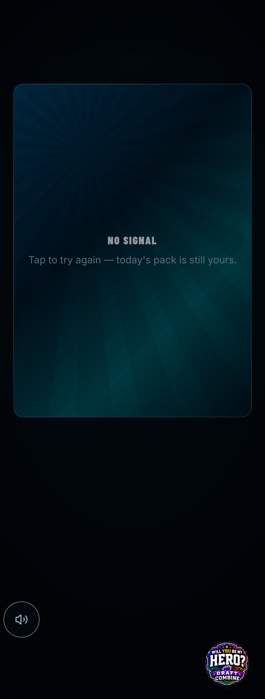 | 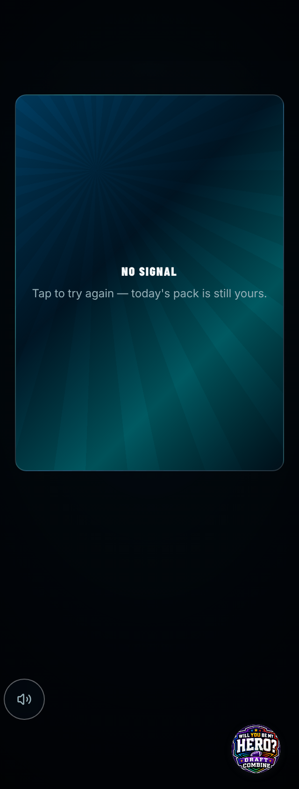 |
| `pack-retry-320x568.png` | **changed 25.79%** | 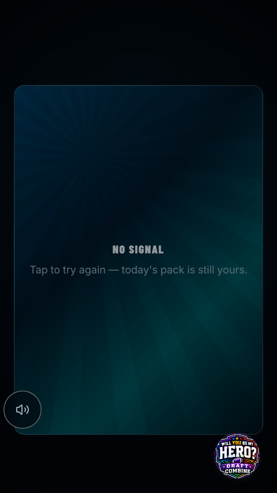 | 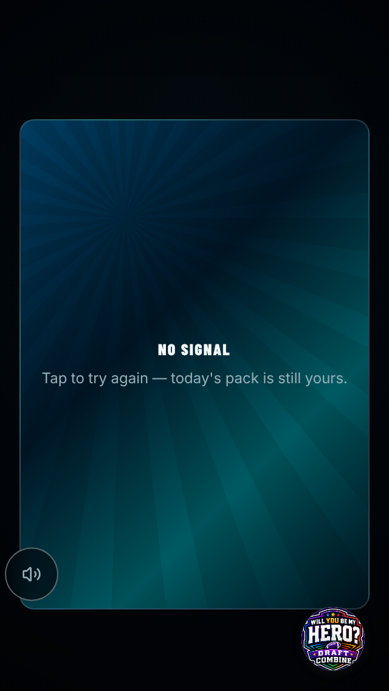 |
| `pack-retry-390.png` | **changed 17.19%** | 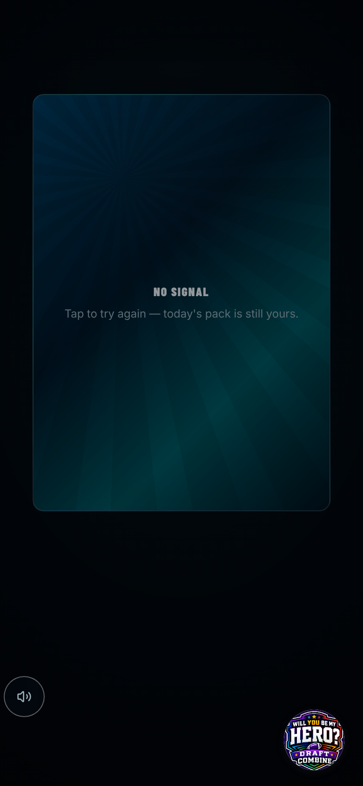 | 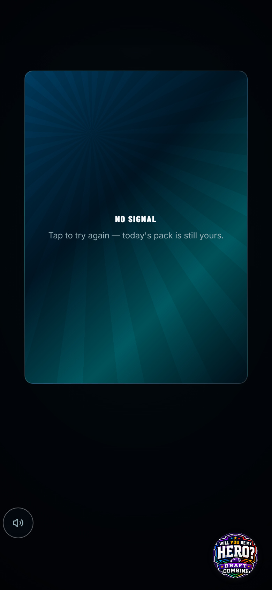 |
| `pack-sealed-320.png` | **changed 0.56%** | 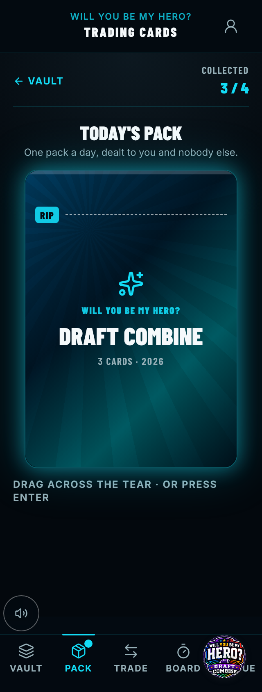 | 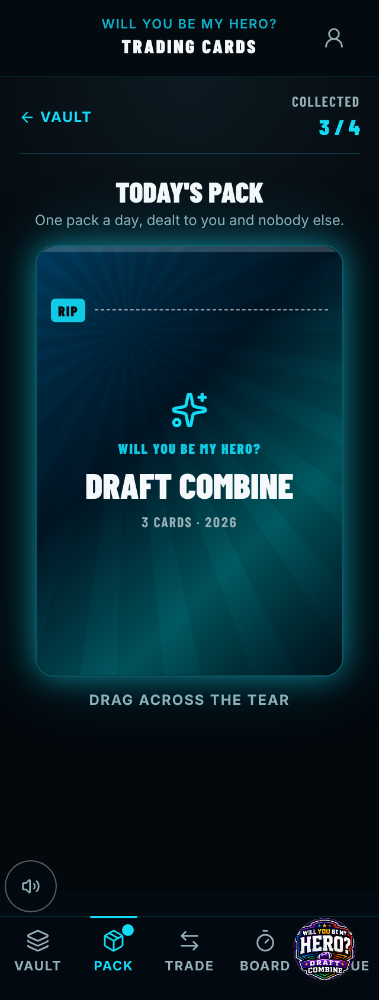 |
| `pack-sealed-390.png` | **changed 0.47%** | 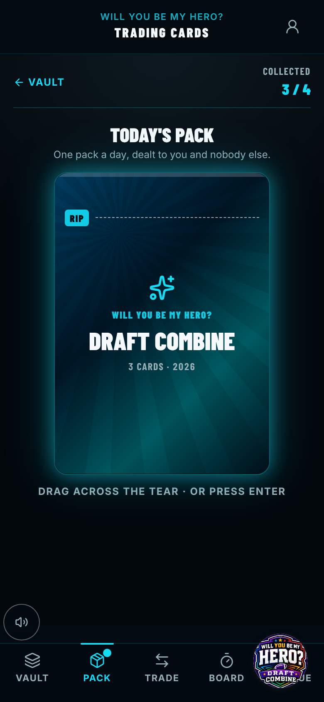 | 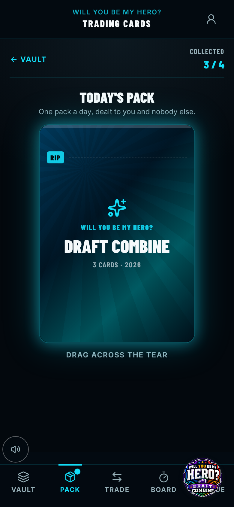 |
| `pack-stand-320x568.png` | **changed 17.95%** |  |  |
| `pack-sealed-320x568.png` | identical | 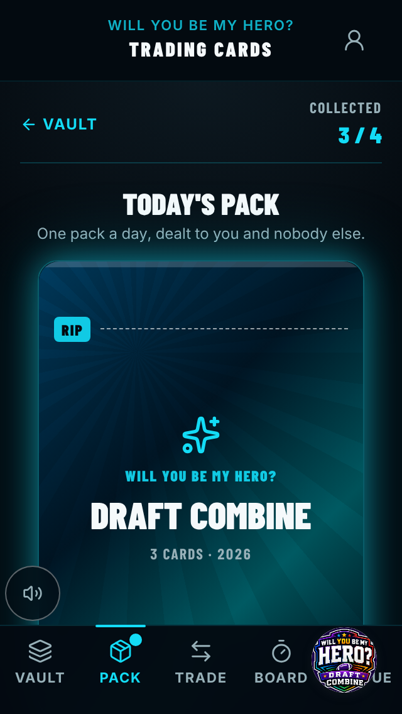 |  |
