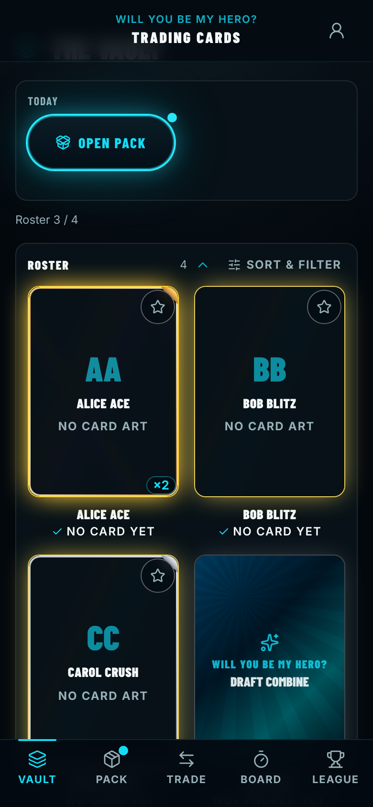
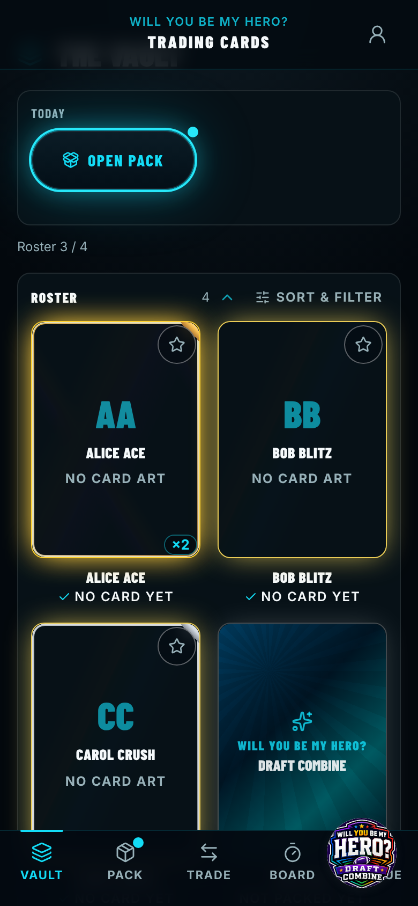
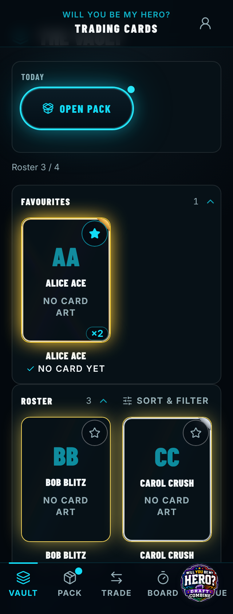
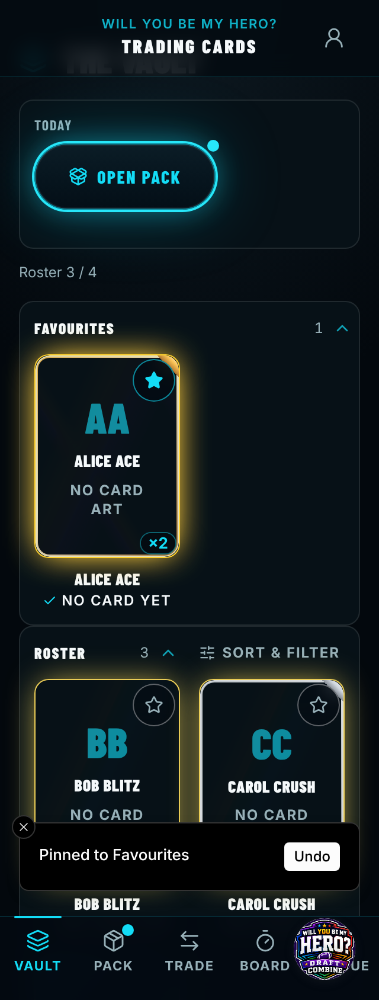
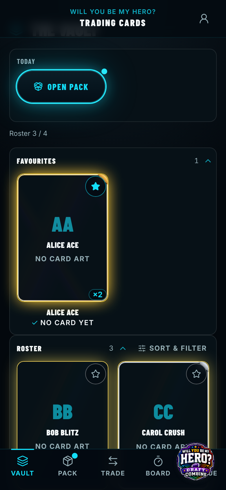
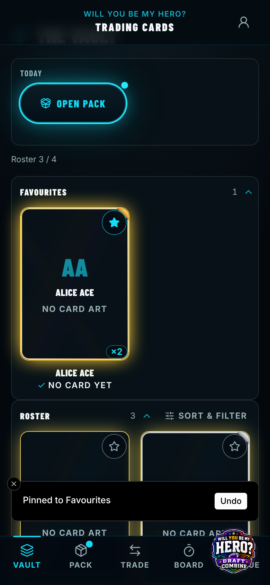
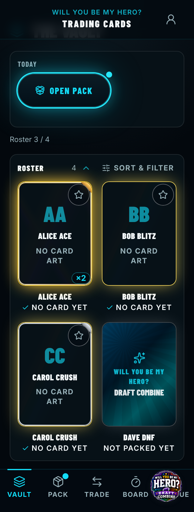

# Before / after — 2026-11-06-vault-feedback-toast-when-a-card-is-pinn

> Captured against stubbed data (no live backend). The "Live feed down" banner, an artifact of the
> capture's deliberately dead backend that appears at random moments, is hidden in both sets.

| Capture | Pixels | Before | After |
| --- | --- | --- | --- |
| `vault-390.png` | **changed 0.78%** |  |  |
| `vault-pinned-320.png` | **changed 6.10%** |  |  |
| `vault-pinned-390.png` | **changed 6.29%** |  |  |
| `vault-320.png` | identical |  |  |
