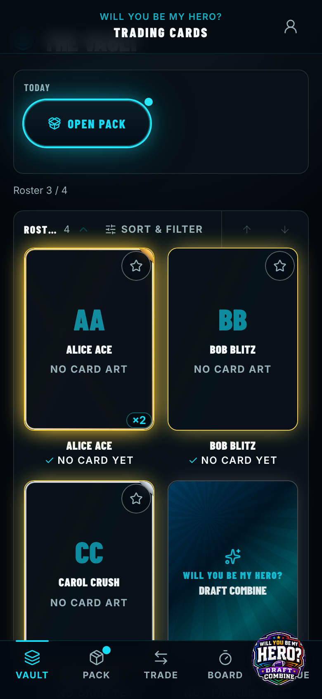
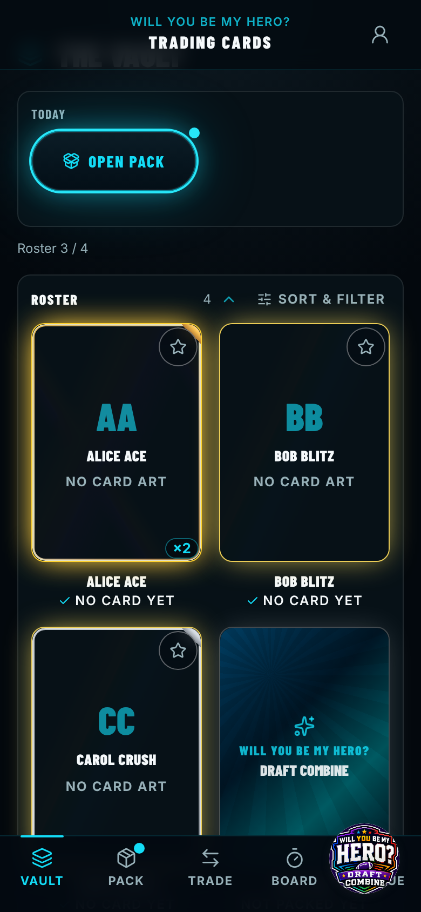
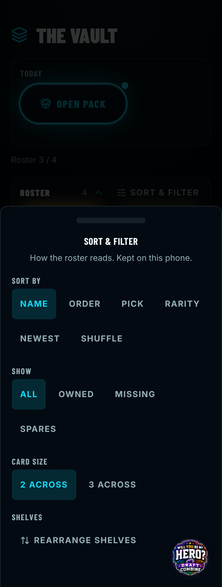
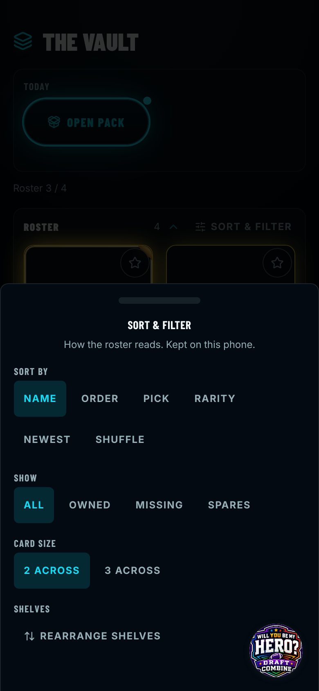

# Before / after — 2026-11-06-vault-mobile-polish-six-small-defects

> Captured against stubbed data (no live backend). The "Live feed down" banner, an artifact of the
> capture's deliberately dead backend that appears at random moments, is hidden in both sets.

| Capture | Pixels | Before | After |
| --- | --- | --- | --- |
| `vault-rearranging-320.png` | **changed 0.29%** |  |  |
| `vault-rearranging-390.png` | **changed 0.20%** |  |  |
| `vault-secrets-error-320.png` | **changed 26.94%** |  |  |
| `vault-secrets-error-390.png` | **changed 19.92%** |  |  |
| `vault-sort-sheet-320.png` | **changed 0.46%** |  |  |
| `vault-sort-sheet-390.png` | **changed 0.38%** |  |  |
| `vault-320.png` | identical |  |  |
