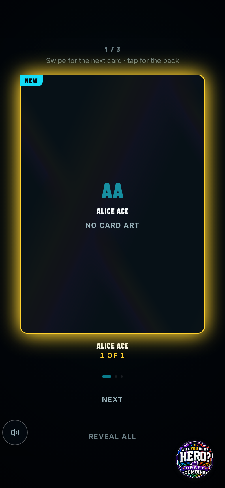
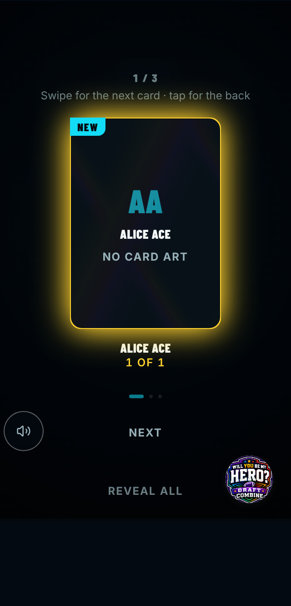

# Before / after — 2026-11-08-address-pr-209-review-findings-cubic-too

> Captured against stubbed data (no live backend). The "Live feed down" banner, an artifact of the
> capture's deliberately dead backend that appears at random moments, is hidden in both sets.

| Capture | Pixels | Before | After |
| --- | --- | --- | --- |
| `pack-stand-390.png` | **changed 0.00%** |  |  |
| `pack-stand-320x568-full.png` | identical |  |  |
